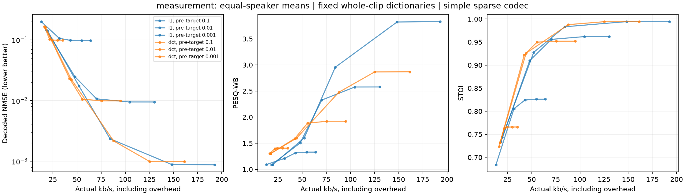

# L1 sparse-coding: first measured results

**The experiment works end to end, but this L1 configuration does not beat DCT
thresholding on bytes needed to satisfy the tested waveform-error limits.**
This is an exploratory fixed-family comparison, not a negative result about all
L1 methods or a claim about the unknown sparsest domain.

The run encoded 120 two-second LibriSpeech dev-clean clips from 40 speakers:
20 calibration speakers and 20 measurement speakers, with three distinct source
utterances each. The 200 earlier checkpoint-selection utterances were excluded.
Selection used source IDs, durations and centered crops, not acoustic/model scores.
All settings were fixed across both groups; no neural model was trained or fitted.
The 40 development speakers have been used in earlier work, so neither group is
an untouched final confirmation set.

## Reconstruction and rate

The table uses the **20 measurement speakers / 60 clips**. For each clip and
maximum NMSE, choose the smallest actual bitstream meeting that limit from the
declared inference/quantizer grid. Both methods have feasible candidates for all
60 clips at all three limits. Rates and quality are averaged within speaker first.

| Maximum final NMSE | L1 kb/s | DCT kb/s | Extra L1 rate | Paired-speaker 95% CI for extra rate |
|---:|---:|---:|---:|---:|
| 0.1 | 39.249 | 24.162 | +62.44% | +50.52% to +74.21% |
| 0.01 | 78.894 | 73.736 | +7.00% | -0.97% to +16.57% |
| 0.001 | 148.257 | 126.803 | +16.92% | +11.07% to +23.05% |

Intervals use 1,000 paired speaker bootstrap draws. The 0.01 interval crosses
zero; this pilot does not establish a rate disadvantage at that limit. All rates
include the header, support positions/bitmap, coefficient values, quantizer step
and padding. The reference rate for raw mono 16-kHz PCM16 is 256 kb/s.

Actual achieved quality at those selected points:

| Maximum NMSE | Method | Mean final NMSE | PESQ-WB | STOI | Mean transmitted nonzeros |
|---:|---|---:|---:|---:|---:|
| 0.1 | L1 | 0.086114 | 1.293 | 0.826 | 3,921 |
| 0.1 | DCT | 0.099081 | 1.403 | 0.766 | 2,734 |
| 0.01 | L1 | 0.003723 | 2.744 | 0.979 | 12,032 |
| 0.01 | DCT | 0.009374 | 1.978 | 0.952 | 10,398 |
| 0.001 | L1 | 0.000881 | 3.823 | 0.994 | 19,357 |
| 0.001 | DCT | 0.000994 | 2.867 | 0.994 | 18,162 |

These are common **upper error limits**, not exactly equal achieved errors.
The finite grid can select a tighter inference target with coarse quantization;
the substantially lower achieved L1 error at the 0.01 limit is a clear example.
Do not attribute the corresponding PESQ increase entirely to a better perceptual
representation at equal waveform error. Matched-bitrate comparisons and their
coverage are also available in [the full comparison table](l1_comparison.csv).

Original-versus-itself scores were PESQ-WB **4.643888** and STOI approximately
**1.0**, using the same implementations. These are self-reference scores, not
independent labels of perceptual quality. All 3,600 reconstructed-speech PESQ and
STOI measurements were valid. ViSQOL remains unimplemented, with explicit status.



Each curve fixes the inference target and varies coefficient precision; it shows
measured settings rather than a claimed interpolated frontier. The DCT bank has
32,000 candidate coordinates; the impulse-plus-DCT bank has 64,000. Nonzero count
and its fraction must therefore be distinguished from actual transmitted bytes.

## What the optimization established

All **360/360 speech L1 fits** met the declared constrained relative primal-dual
gap tolerance of **0.01** and their pre-quantization error constraints. The worst
relative gap was **0.00992806**. This is evidence of approximate minimum **L1 norm
within the fixed dictionary**, not minimum support or minimum bitrate.

The full grid contains **3,600 saved and decoded bitstreams**: 120 sources, two
methods, three inference targets and five precisions. An independent second pass
decoded every stream and recomputed its NMSE from the source crops; the maximum
discrepancy from the saved measurements was **1.11e-16**. Every recorded bit count
and nonzero count also matched the independently parsed stream.

Small independent tests compare the operators against an explicit cosine matrix,
Lasso against closed-form soft thresholding, and constrained L1 against an SLSQP
positive/negative-variable formulation. Codec tests cover both support modes,
all five precisions, padding, zero codes, single-coordinate codes and malformed
streams. The complete project suite passes **103 tests**.

The five synthetic inputs are sanity checks, not a population experiment:

| Signal | L1 nonzeros before quantization at nominal NMSE 0.01 |
|---|---:|
| Silence | 0 |
| Impulse | 1 |
| Exact cosine atom | 1 |
| Tone/event mixture | 199 |
| Seeded broadband noise | 29,488 |

All 15 synthetic L1 fits converged under the same constrained-gap tolerance. This
confirms that the dictionary can exploit matching structure; it does not establish
universal audio sparsity. At 16-bit coefficient precision the noise stream reaches
268 kb/s, exceeding the raw PCM16 reference once support/metadata are included.

## Interpretation

- An L1 representation with controlled reconstruction error is computationally
  feasible here. The complete speech sweep took about **109 seconds** on this
  workstation with four CPU processes; no GPU training was required.
- For selected measurement points, full L1 inference plus packing averaged about
  0.295, 0.844 and 0.879 seconds per two-second clip at the three error limits.
  Corresponding DCT encoding averaged about 0.0020, 0.0024 and 0.0032 seconds.
  These are per-candidate CPU timings under concurrency, excluding disk I/O,
  metric evaluation and searching the final multi-candidate grid.
- L1 magnitude minimization can retain more coefficients and require more bits
  than fixed-basis thresholding. The impulse/DCT dictionary, shrinkage, support
  coding and quantization all affect the result; this experiment does not isolate
  their individual causes or compare identical representation families.
- PESQ, STOI and waveform error rank some operating points differently. Keep the
  measures separate. No improvement over a conventional audio codec is claimed.

## Reproduce and inspect

See [the protocol and implementation details](l1_experiment.md) and
[YAML instructions](../configs/README.md). The main command is:

```powershell
python run.py study --config configs/study_l1_librispeech.yaml
```

The speech run is `l1_librispeech_20261029T110402750634Z`; the synthetic run is
`l1_synthetic_20261029T110330790973Z`. The two-speaker smoke run was separate.
Audio, solver paths and bitstreams remain under these ignored local run folders.

- [All decoded measurements and bit accounting](l1_metrics.csv).
- [Matched-quality and matched-rate summaries](l1_comparison.csv).
- [Paired rate comparisons and intervals](l1_paired_rates.csv).
- [Every solver's feasibility/gap record](l1_solver.csv).
- [Self-reference speech metrics](l1_reference_metrics.csv).
- [Cohort identities, source/crop hashes and exclusions](l1_cohort.json).
- [Summary](l1_results.json) and [run provenance, artifact hashes and environment](l1_runs.json).

The export command verifies source artifacts before publishing selected results:

```powershell
python tools/export_l1_results.py --run runs/l1_librispeech_20261029T110402750634Z --synthetic-run runs/l1_synthetic_20261029T110330790973Z
```

The implementation follows the sources listed in the protocol: basis pursuit,
proximal algorithms, FISTA and adaptive restart. Newly reviewed titles/authors
are recorded in [bibliography.md](../bibliography.md).
