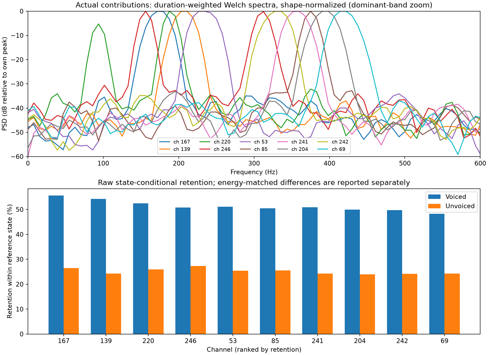
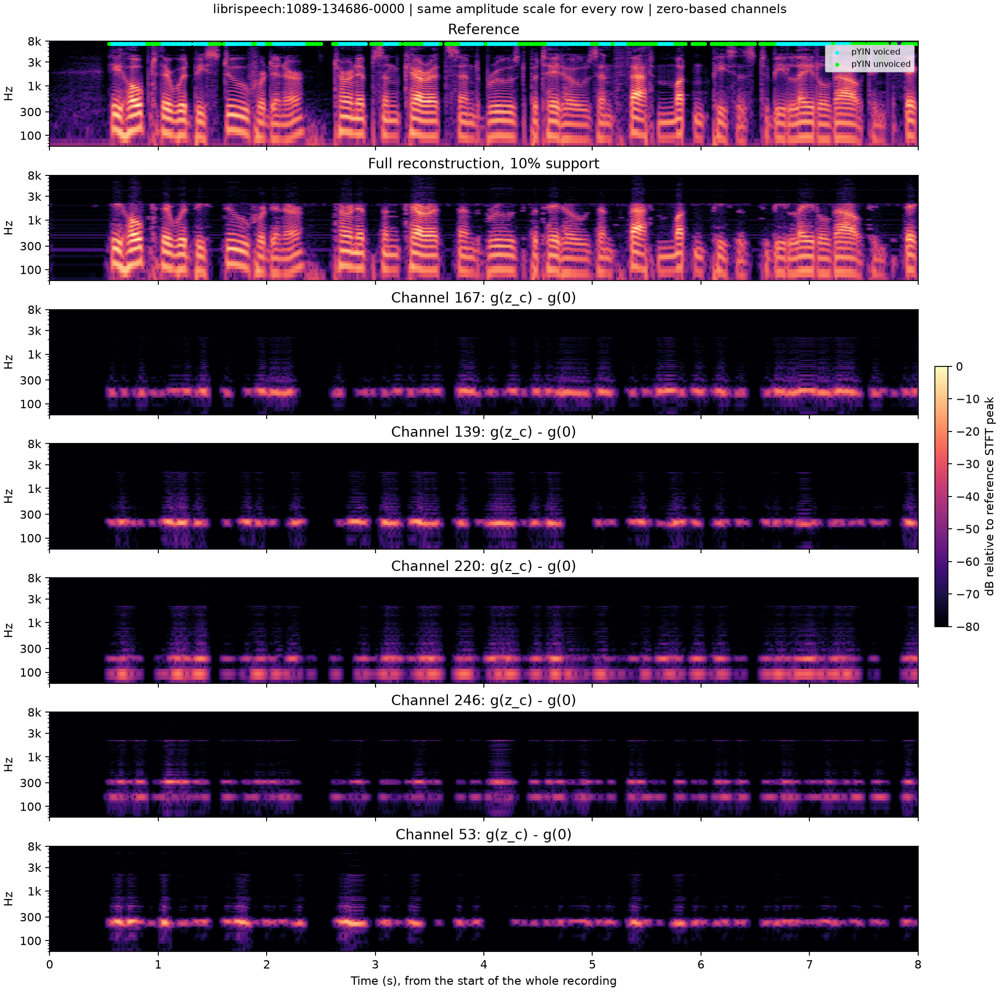
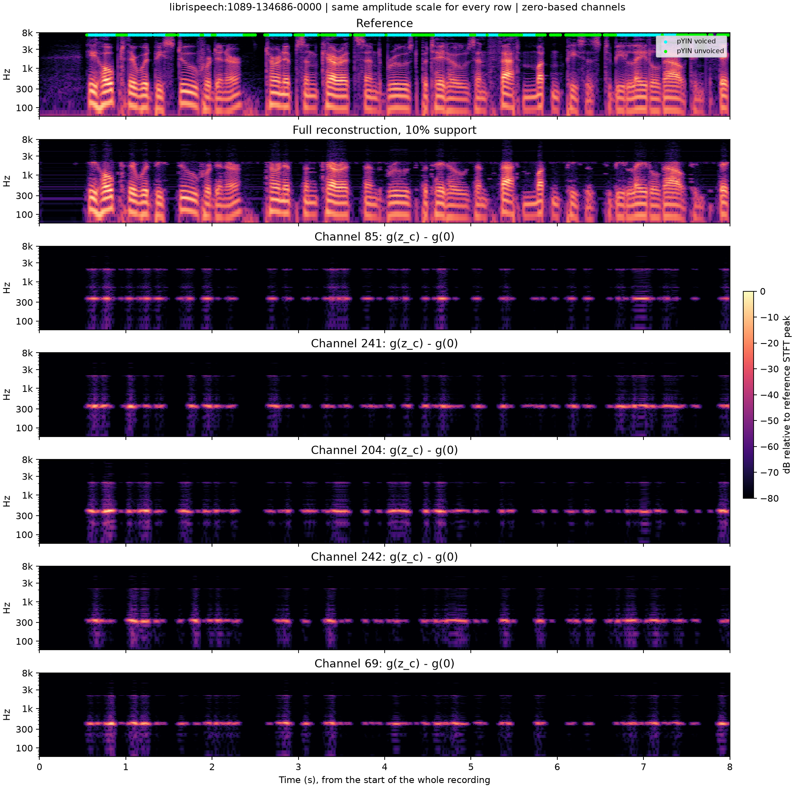
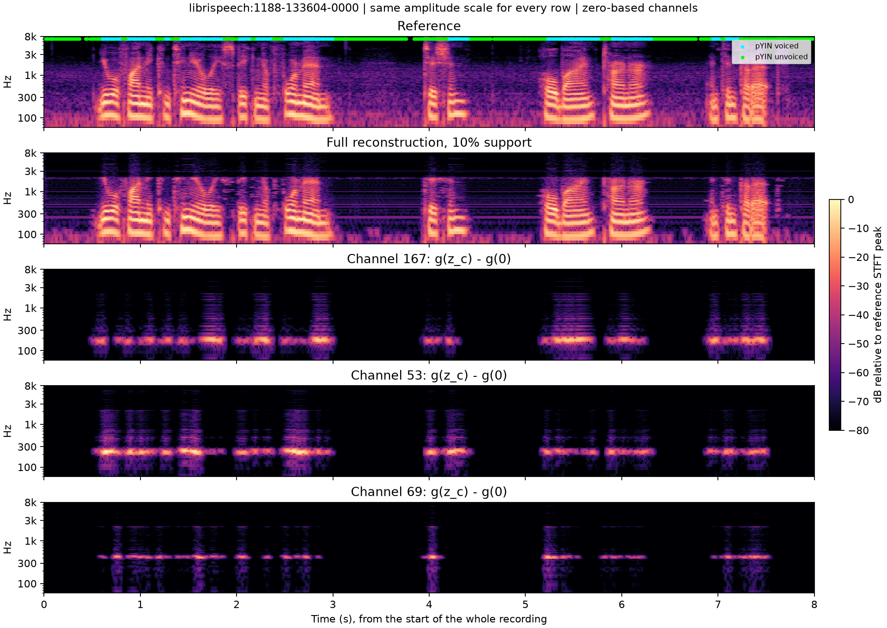

# Ten most frequently retained S-AF channels at 10% support

Frozen S-AF checkpoint at step 20000; all 2,620 test-clean recordings, 40 speakers, 5.403 hours. No retraining. Channels are **zero-based**.

## Concrete result

The ten channels account for 14.11% of retained coefficients. Minimum recording coverage is 100.0%; individual retention is 34.14–38.89% of valid time positions. Their data-driven synthesis spectra are predominantly low-frequency, frequency-selective components. Dominant PSD peaks span 156.2–414.1 Hz; 8 of ten have 90% of spectral energy within a band no wider than 40 Hz.

10 of ten have positive energy-matched voiced association: estimated retention-rate differences range from 2.99 to 16.98 percentage points, with descriptive 95% speaker-bootstrap intervals shown below. They remain active in many unvoiced frames and should not be named exclusive voicing detectors. Other channels were not selected for this top-ten characterization.

For 10 of ten channels, uncompensated removal increases mean waveform NMSE. The largest increase among them is channel 53 (+0.04723), showing that retention frequency and ablation importance are distinct rankings.

## Retention and coefficient distributions

Retention is the fraction of valid 16-ms latent time positions at which this channel has a nonzero retained coefficient. Ranking uses its count across the complete corpus, not the number of recordings containing the channel. Magnitude distributions condition on retained nonzero coefficients; the complement of retention is a point mass at zero. Absolute values are in learned latent units and are not comparable measures of importance across arbitrary encoder/decoder scalings.

| Rank | Channel | Retained positions % | Share of all retained % | Absolute z: p05 / median / p95 | Absolute z: mean / SD | Negative % |
|---:|---:|---:|---:|---|---|---:|
| 1 | 167 | 38.89 | 1.52 | 0.04978 / 0.20513 / 1.4796 | 0.41104 / 0.54937 | 50.8 |
| 2 | 139 | 37.49 | 1.46 | 0.049293 / 0.19208 / 1.47 | 0.39947 / 0.53921 | 49.6 |
| 3 | 220 | 36.99 | 1.44 | 0.047263 / 0.15784 / 1.0623 | 0.30167 / 0.38274 | 50.2 |
| 4 | 246 | 36.45 | 1.42 | 0.045563 / 0.1425 / 0.97485 | 0.28009 / 0.4035 | 50.1 |
| 5 | 53 | 36.06 | 1.41 | 0.048104 / 0.18369 / 1.6 | 0.41187 / 0.61029 | 51.3 |
| 6 | 85 | 35.76 | 1.40 | 0.045631 / 0.13897 / 0.80644 | 0.24656 / 0.31211 | 50.4 |
| 7 | 241 | 35.59 | 1.39 | 0.047859 / 0.1743 / 1.2453 | 0.35074 / 0.49815 | 50.2 |
| 8 | 204 | 34.98 | 1.37 | 0.047764 / 0.17212 / 1.2912 | 0.35674 / 0.51581 | 50.6 |
| 9 | 242 | 34.93 | 1.36 | 0.047048 / 0.16729 / 1.2329 | 0.34631 / 0.51417 | 49.9 |
| 10 | 69 | 34.14 | 1.33 | 0.047332 / 0.16817 / 1.3049 | 0.35666 / 0.53432 | 50.8 |

## Synthesis contribution and frequency content

For the affine decoder g(z)=Az+b, the isolated contribution is **y_c=g(z_c)-g(0)**, not g(z_c). The full reconstruction is g(0)+sum_c y_c. The length-dependent bias waveform is included only once. All other retained values are fixed during channel ablation; top-k is not rerun. The reported ablation score is mean [(||xhat-y_c-x||²-||xhat-x||²)/||x||²]; positive values mean removal worsens waveform NMSE.

Spectra use actual complete-recording contributions, duration-weighted Welch PSD (Hann 2048, overlap 1536, 16 kHz, no detrending; 7.8125-Hz bins). The 5–95% spectral energy interval is a bandwidth summary, not a pitch range. Strong PSD peaks are local maxima within 12 dB of the largest peak, separated by at least three frequency bins. Interior unit-impulse peaks describe the decoder filter separately; actual peaks also depend on coefficient sequences. Channel energies are non-additive because these contributions need not be orthogonal.

Attribution uses native FP32 convolutions with cuDNN/TF32 disabled in the decoder while retaining the original encoder precision and selected coefficients. This improves numerical consistency of the affine decomposition without changing weights. The correction pass checks the waveform difference from default decoding and reports it below.

| Channel | Strong PSD peaks Hz (largest first) | Centroid Hz | 5–95% energy Hz | Energy <300 / 300–1000 / 1–3k / >3k % | Unit-impulse peak Hz | Ablation ΔNMSE |
|---:|---:|---:|---|---|---:|---:|
| 167 | 171.9 | 175.2 | 156.2–187.5 | 99.9 / 0.1 / 0.0 / 0.0 | 179.7 | 0.036950 |
| 139 | 210.9 | 207.9 | 195.3–218.8 | 99.9 / 0.1 / 0.0 / 0.0 | 210.9 | 0.041455 |
| 220 | 187.5 / 93.8 | 170.6 | 85.9–195.3 | 99.8 / 0.1 / 0.1 / 0.0 | 190.4 | 0.015126 |
| 246 | 156.2 / 312.5 | 248.3 | 148.4–320.3 | 49.8 / 49.7 / 0.5 / 0.0 | 156.2 | 0.011516 |
| 53 | 234.4 | 234.2 | 218.8–250.0 | 99.9 / 0.1 / 0.0 / 0.0 | 225.6 | 0.047228 |
| 85 | 375.0 | 433.6 | 367.2–390.6 | 0.1 / 96.5 / 3.5 / 0.0 | 375.0 | 0.007703 |
| 241 | 359.4 | 362.3 | 343.8–375.0 | 0.0 / 99.6 / 0.3 / 0.0 | 352.5 | 0.026225 |
| 204 | 390.6 | 400.8 | 375.0–414.1 | 0.1 / 99.5 / 0.4 / 0.0 | 397.5 | 0.028637 |
| 242 | 328.1 | 332.8 | 312.5–343.8 | 0.5 / 99.4 / 0.2 / 0.0 | 335.9 | 0.025567 |
| 69 | 414.1 | 424.2 | 398.4–437.5 | 0.1 / 99.6 / 0.3 / 0.0 | 415.0 | 0.029650 |

## Voiced/unvoiced association

Reference labels use [pYIN (Mauch & Dixon, 2014)](https://webspace.eecs.qmul.ac.uk/s.e.dixon/pub/2014/MauchDixon-PYIN-ICASSP2014.pdf) via [librosa 0.11](https://librosa.org/doc/0.11.0/generated/librosa.pyin.html): 50–600 Hz, 1024-sample centered frames and 256-sample hop. Low-energy frames below max(1e-4 RMS, peak frame RMS −35 dB) are excluded from the voiced/unvoiced comparison, not counted as unvoiced. There are 677,996 voiced, 363,700 unvoiced and 175,322 excluded low-energy valid time positions. The baseline voiced fraction among included frames is 65.09%.

Raw phi is the point-biserial correlation between retention and the binary voiced flag, conditional on above-threshold energy. To reduce energy confounding, match frames within recording and 3-dB RMS bins with at least five frames of each state; weight each stratum by nV*nU/(nV+nU), aggregate within speaker, then average speakers equally. Eligible strata contain 443,330 voiced and 253,710 unvoiced frames; the adjusted estimate therefore concerns their common energy support. Intervals are 2,000-resample paired-speaker percentile bootstrap intervals (seed 0) for this matched rate difference. They are descriptive, unadjusted for ten channel comparisons, and conditional on this fixed model and ranking. Positive difference means preferential retention in voiced frames at matched coarse energy, negative means unvoiced. These are exploratory associations with automatic labels, not ground-truth phonetic classes, independent features, or proof of a learned detector.

| Channel | Retained in voiced % | Retained in unvoiced % | Raw phi | Energy-matched V−U difference, percentage points [95% CI] | Adjusted association |
|---:|---:|---:|---:|---|---|
| 167 | 55.56 | 26.46 | 0.279 | +16.98 [+13.84, +20.37] | voiced |
| 139 | 54.25 | 24.25 | 0.288 | +13.63 [+10.70, +16.77] | voiced |
| 220 | 52.44 | 25.89 | 0.255 | +13.09 [+10.08, +16.43] | voiced |
| 246 | 50.73 | 27.35 | 0.225 | +8.01 [+5.37, +10.86] | voiced |
| 53 | 51.08 | 25.39 | 0.248 | +10.06 [+7.44, +12.71] | voiced |
| 85 | 50.49 | 25.51 | 0.241 | +2.99 [+0.93, +5.05] | voiced |
| 241 | 50.86 | 24.26 | 0.257 | +8.62 [+6.61, +10.79] | voiced |
| 204 | 49.91 | 23.97 | 0.252 | +6.79 [+4.59, +9.09] | voiced |
| 242 | 49.68 | 24.21 | 0.247 | +8.97 [+7.04, +11.04] | voiced |
| 69 | 48.25 | 24.25 | 0.234 | +4.77 [+2.64, +6.98] | voiced |

The CSV/JSON also retain sensitivity analyses: high-confidence pYIN labels (voiced probability ≥0.5 or unvoiced ≤0.1) and stable-state labels persisting ±4 latent frames. The encoder's 127.6-ms receptive field can span transitions, so a center-frame association does not establish a strictly localized phonetic response.

## Individual reconstructed-channel spectrograms

Examples are selected by manifest speaker order and duration ≥6 s, before inspecting activations. Figures crop the first eight seconds **after** whole-recording 10% support selection and synthesis. Every row in each figure uses the same dB scale relative to the reference STFT peak; individual channels are not independently amplified. Frequency axes are logarithmic, 60–8000 Hz. Cyan/green dots on the reference mark automatic voiced/unvoiced frames. Spectrogram magnitudes do not add, even though the underlying affine contribution waveforms do.

Numerical isolated-versus-ablation identity: maximum absolute waveform discrepancy 2.98e-07 on the displayed full-recording examples. Differences arise from float32 arithmetic.

Full distributions, recording coverage, band powers, bootstrap intervals and protocol hashes: [statistics CSV](saf_channel_statistics.csv), [analysis JSON](saf_channel_analysis.json), [all 256 channel rankings](saf_channel_ranking.csv). Raw example arrays and spectra stay under the run's analysis directory.

Reproduce from the project root with `python tools/analyze_channels.py`; source/checkpoint paths can be changed with `--run`. This is a post-hoc characterization of the already evaluated test set, not a new independent test of an architecture selected using these findings.

IEEE-FP32 versus default decoder: corpus relative RMS difference 0.0003543; maximum absolute sample difference 0.0007894. See [PyTorch's TF32 notes](https://docs.pytorch.org/docs/2.8/notes/cuda.html#tensorfloat-32-tf32-on-ampere-and-later-devices).

Bias + ten isolated channels + the remaining channels also matches full decoding: maximum absolute discrepancy 6.26e-07 on the displayed recordings.
