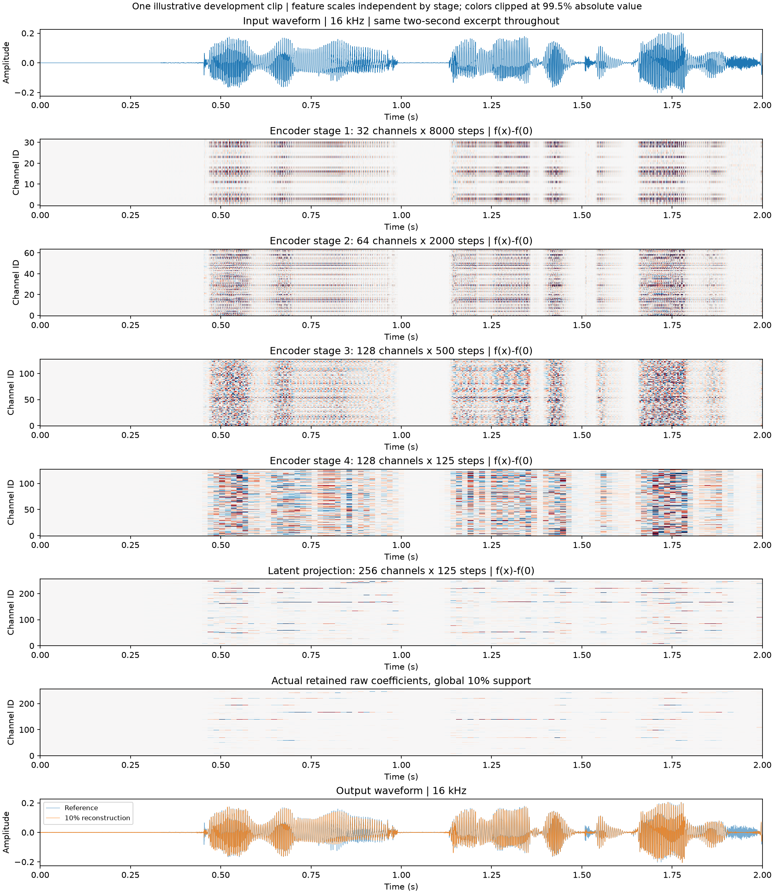
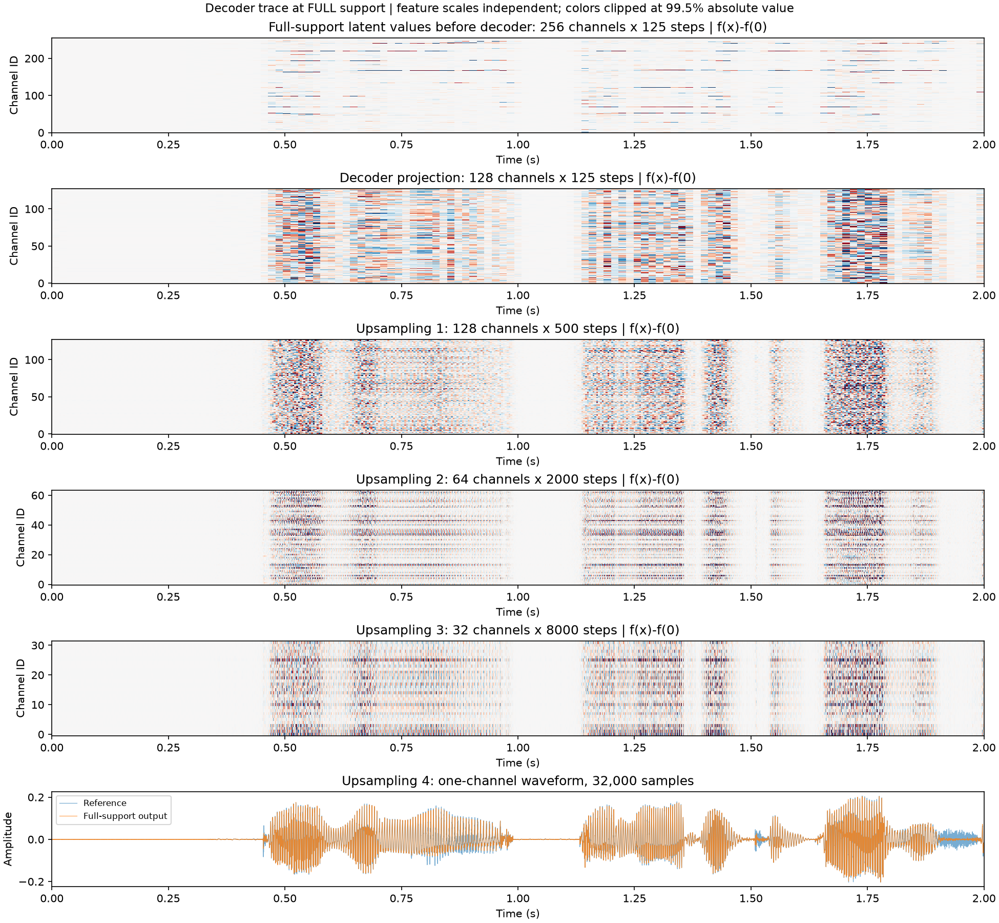
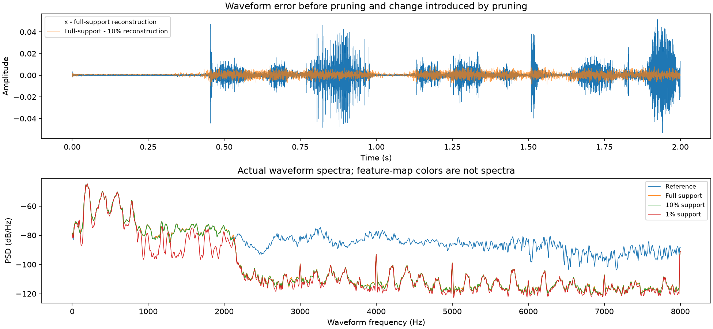

# Understanding S-AF one module at a time

We need to distinguish **what a block computes**, **what survives through it**,
and **whether that block is necessary**. These are different experiments.
The current architecture is a baseline, not a set of experimentally justified
design choices. The audit below is intended to earn or revise those choices.

An initial reproducible trace is implemented and run. The controlled experiments
described after it are a research plan, not completed results.

## The exact signal path

For a two-second, 16-kHz waveform, the measured shapes are:

| Boundary | Shape: channels × time steps | Scalar values | Feature-grid rate | Input receptive field |
|---|---:|---:|---:|---:|
| Input | 1 × 32,000 | 32,000 | 16,000 Hz | 1 sample |
| Encoder 1, after residual | 32 × 8,000 | 256,000 | 4,000 Hz | 25 samples / 1.56 ms |
| Encoder 2, after residual | 64 × 2,000 | 128,000 | 1,000 Hz | 121 samples / 7.56 ms |
| Encoder 3, after residual | 128 × 500 | 64,000 | 250 Hz | 505 samples / 31.56 ms |
| Encoder 4, after residual | 128 × 125 | 16,000 | 62.5 Hz | 2,041 samples / 127.56 ms |
| Encoder 1×1 projection | 256 × 125 | 32,000 | 62.5 Hz | 2,041 samples / 127.56 ms |
| Global top-k, 10% | 256 × 125, masked | 3,200 selected | 62.5 Hz | Selection also depends on the whole excerpt |
| Decoder 1×1 projection | 128 × 125 | 16,000 | 62.5 Hz | — |
| Decoder upsampling 1 | 128 × 500 | 64,000 | 250 Hz | — |
| Decoder upsampling 2 | 64 × 2,000 | 128,000 | 1,000 Hz | — |
| Decoder upsampling 3 | 32 × 8,000 | 256,000 | 4,000 Hz | — |
| Output, upsampling 4 | 1 × 32,000 | 32,000 | 16,000 Hz | — |

The output rate of a feature channel is **not its preferred input audio
frequency**. A 62.5-Hz latent grid can encode higher-frequency waveform content
across channels. Effective filters and phase/aliasing tests are required to
understand that content; playing an intermediate feature as 16-kHz audio or
calling its temporal FFT an input-frequency response would be misleading.

| Module | What it mathematically provides | What we still need to establish |
|---|---|---|
| Strided convolutions | Learned local filtering, channel mixing and decimation | Which waveform directions survive; whether aliasing cancels across channels |
| Residual blocks | An identity path plus a learned affine filtering correction | Whether the correction improves synthesis, conditioning or training |
| Identity activations | No operation; retained from the shared baseline implementation | No representational function to discover here |
| Encoder 1×1 projection | An instantaneous change from 128 to 256 coordinates | Whether these extra coordinates improve sparse reconstruction at matched budgets |
| Global magnitude top-k | Input-dependent selection of signed coefficient coordinates | Whether magnitude selects useful reconstruction information rather than merely large values |
| Decoder 1×1 projection | Mixing 256 codes into 128 synthesis drives per frame | Which latent combinations cancel or provide redundant synthesis information |
| Transposed convolutions | Learned upsampling and synthesis filtering | Which frequencies they can reconstruct, and how they suppress imaging/grid artifacts |
| Biases | Input-independent offsets, potentially with boundary/grid structure | Whether offsets aid reconstruction or influence sparse selection unnecessarily |

Both encoder and decoder are affine. For a fixed input length their complete
operation can be written as:

```text
z = A x + a
retained_z = top_k(z)
reconstruction = B retained_z + b
```

Successive blocks therefore do not establish a hierarchy of nonlinear speech
properties. Their parameterization can matter for optimization, receptive field
and multirate structure. Moreover, invertible changes of internal channel basis
can be absorbed by adjacent affine layers while preserving the final code and
output. An internal neuron is not automatically an identifiable acoustic object.

## Initial trace: completed

The example is the first source from the existing development intervention
cohort, `librispeech:84-121123-0005`, first two seconds, normalized to waveform
RMS 0.05. It was not chosen by reconstruction quality. The checkpoint and source
manifest hashes are checked against the frozen pitch study. No weights change.

The encoder figure follows the same signal through the four stage boundaries,
latent projection, sparse selection and final reconstruction. Encoder feature
maps show **f(x) − f(0)**. The top-k panel instead shows the actual retained raw
coefficients used for reconstruction. Every feature map has its own color scale;
channel indices are not frequency labels or matched identities across stages.



The decoder figure separately traces **full support**, to inspect the unpruned
path before attributing error to selection. The CSV also records each residual
block, including those not shown as separate feature maps.
For decoder maps, the zero baseline means **zero latent values**, not a zero
waveform passed through the encoder; these are distinct because the encoder has
biases.



Four concrete findings already sharpen the questions:

1. **The 256-channel expansion adds coordinates, not information.** Its 256×128
   matrix has numerical rank 128 and condition number 4.77. The decoder's
   128×256 projection has numerical rank 128, condition number 5.24 and a
   128-dimensional nullspace per frame. Ranks use a documented FP32-relative
   tolerance; these are local projection measurements, not the rank or
   conditioning of the entire encoder/decoder.
2. **Raw activation size mixes offsets with signal response.** The first
   convolution has raw RMS 0.1285, zero-input RMS 0.1240, and signal-dependent
   RMS 0.0336. Its residual branch has raw input/update cosine −0.929, but
   bias-centered cosine −0.140. A claim that this block mostly cancels speech
   based on the raw cosine would therefore be wrong. Norms in different learned
   coordinate systems are not information-retention scores.
3. **Zero input is not mapped exactly to zero.** Output RMS is 0.000300 at full
   support and 0.000343 at 10% support. This is small relative to the example's
   0.05 input RMS; nonzero output alone does not establish a major defect.
4. **The example's main waveform error already exists without pruning.**
   Full-support NMSE is 0.01113; 10% NMSE is 0.01253. The corresponding SNRs
   are 19.54 and 19.02 dB. These are one-clip values, not new population scores.

For the example at 10% support, the exact decomposition is:

```text
e = x - full_reconstruction
d = full_reconstruction - sparse_reconstruction

NMSE_sparse = ||e||²/||x||² + ||d||²/||x||² + 2<e,d>/||x||²
            = 0.01112676 + 0.00157748 - 0.00017668
            = 0.01252756
```

Pruning distortion is not automatically an additive, independent share of
reconstruction loss: its interaction with existing error matters.



The spectrum suggests a useful first target: on this example, full-support
reconstruction attenuates much of the content above approximately 2 kHz.
An **exploratory, post-visualization** Fourier-band check finds 94.36% of its
full-support squared error above 2 kHz, although that band contains only 1.12%
of input energy. Its band NMSE is 0.935. This observation does not locate the
loss in a particular module or establish a corpus-wide cutoff. It motivates
asking whether the encoder fails to supply this content, the decoder cannot
synthesize it well, or the training objective favored other content.

## The next examinations, in order

### 1. Probe each stage with known signals

Use zeros, isolated impulses, swept tones, two-tone mixtures, fixed-envelope
harmonic stacks, band-limited/broadband noise and short transients, followed by
real speech. Measure effective analysis filters and synthesis atoms, gain,
phase, response duration, numerical singular values/conditioning where feasible,
and reconstruction error by waveform frequency band.

Begin at full support. Repeat shifted probes at all 256 sample-origin offsets
over one complete latent hop, with padding/boundaries analyzed separately.
Strided analysis plus synthesis may be periodically time-varying: one impulse
or phase does not establish a universal frequency response. Then repeat at 10%
and 1% to expose changes caused by support competition.

The first specific question is **where the apparent high-frequency deficit
arises**. A feature's raw RMS alone cannot answer that; compare sensitivity to
known high-frequency inputs with the actual waveform the decoder can produce.

### 2. Separate encoder prediction from decoder capacity

For each waveform, compare its actual full-support reconstruction with the
least-squares reconstruction obtained by refitting all coefficients while
keeping the decoder frozen. Because synthesis is affine, this is a linear
least-squares problem, including the actual finite-length boundary behavior.
Verify solver convergence using the residual and normal-equation residual.

- If coefficient refitting substantially reduces error, the existing decoder
  can synthesize more than the encoder currently supplies. This does not alone
  distinguish encoder information loss from a poorly learned coefficient map.
- If the verified optimum still misses a band, the limitation is in the frozen
  synthesis subspace for those signals. Distinguish poor conditioning from a
  true numerical/rank limitation; unconstrained fits can require huge coefficients.
- Repeat on the encoder's fixed selected supports. The additional gap to the
  full-code optimum separates selected-support capacity from coefficient accuracy.
  This is diagnostic oracle refitting, not a deployable encoder or sparse optimum.

Use stage-specific linear reconstruction probes to assess recoverability from
earlier feature maps. Evaluate them on separate development recordings and sweep
probe capacity/convergence; failure of a restricted probe is not proof that
information has been destroyed. Dimension counts alone likewise do not measure
information loss on a restricted speech distribution.

### 3. Intervene on modules and coordinate choices

- Bypass one same-shape residual branch at a time. For encoder interventions,
  distinguish recomputed codes/masks from a fixed-mask diagnostic. For decoder
  interventions, start from the same retained codes. Measure waveform, spectral
  and speech-quality changes, including interactions between blocks.
- Compare the residual update with its input after subtracting zero-input
  responses; record spectra, norms and correlations, not just one scalar score.
- Test an encoder-bias-centered selection control with the constant contribution
  restored through synthesis so the dense map remains the same. Keep any known,
  input-independent baseline explicit; introduce no per-recording side information.
- Test reconstruction-aware coordinate scores and decoder-atom-normalized
  selection. Compensated coordinate rescaling can preserve dense reconstruction
  while changing magnitude top-k, so raw coefficient size is not intrinsic importance.
- Examine synthesis nullspace directions, overlap and coefficient compensation;
  this connects to the planned channel/cluster interaction experiments without
  assuming independent slots in advance.

Frozen bypass tests measure sensitivity of this trained system. Removing a block
can cause distribution shift; deterioration does not prove the block is
fundamentally necessary. Architectural necessity requires subsequent controlled
retraining, for example with fewer residual blocks, a wider fourth encoder stage,
or a conventional filter bank under the same reconstruction/support objectives.
State parameter/compute differences explicitly and use multiple training seeds.

### 4. Turn measurements into explanations

For each module, maintain one compact record: **input/output shape and time grid;
effective filtering; zero-input and signal-dependent response; reconstructable
content; intervention result; proposed role; unresolved alternative explanations**.
Claims such as “this stage extracts pitch” require controlled input interventions
and causal reconstruction evidence, beyond a visually structured feature map.
Useful representations need not acquire semantic labels.

Across these comparisons, retain NMSE/SNR, SI-SDR, multiresolution spectral error,
band-wise waveform errors, STOI and PESQ for final speech reconstructions.
PESQ/STOI are not meaningful on arbitrary intermediate feature tensors or generic
synthetic probes. Aggregate by development speaker, report paired uncertainty,
and reserve a fresh evaluation set for later confirmation. Reuse the current
40-speaker development cohort, excluding checkpoint-selection utterances, for
exploration; do not describe it as untouched confirmation.

The first priority is **full-support stage probes plus the frozen-decoder oracle**:
they address a reconstruction deficit already visible before sparse selection.
Architectural changes and retraining follow the diagnosis.
The [earlier population evaluation](sparse_autoencoder_test_results.md) also
reported mean NMSE 0.1032 at full support versus 0.1065 at 10% support. Its PESQ
still changes from 2.472 to 2.027, so similar waveform errors do not make sparse
selection perceptually unimportant. Those are existing exploratory summaries;
no new test-clean measurements were made for this audit.

## Reproduce the completed trace

```powershell
python tools/analyze_modules.py
```

The script requires the existing frozen run, cached development audio and prepared
pitch-study cohort. It checks that the trace matches actual encode/decode outputs
and that the error decomposition holds numerically. It saves no new model weights.

- [Every block's shape, rate, receptive field and response norms](saf_module_trace.csv)
- [Raw and bias-centered residual-branch measurements](saf_module_residuals.csv)
- [Projection singular values, provenance, errors and scope](saf_module_trace.json)
- [Trace implementation](../tools/analyze_modules.py)

Exact example waveforms and retained coefficients remain under the ignored run
directory `analysis/modules/trace.npz`. Existing folders and training code are
unchanged. This document is a reviewed interpretation and plan; the script
regenerates the trace, numeric exports and figures.
