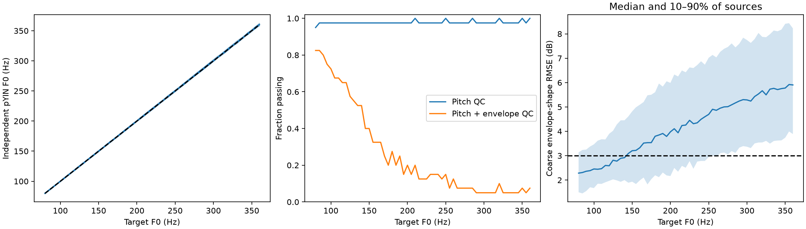
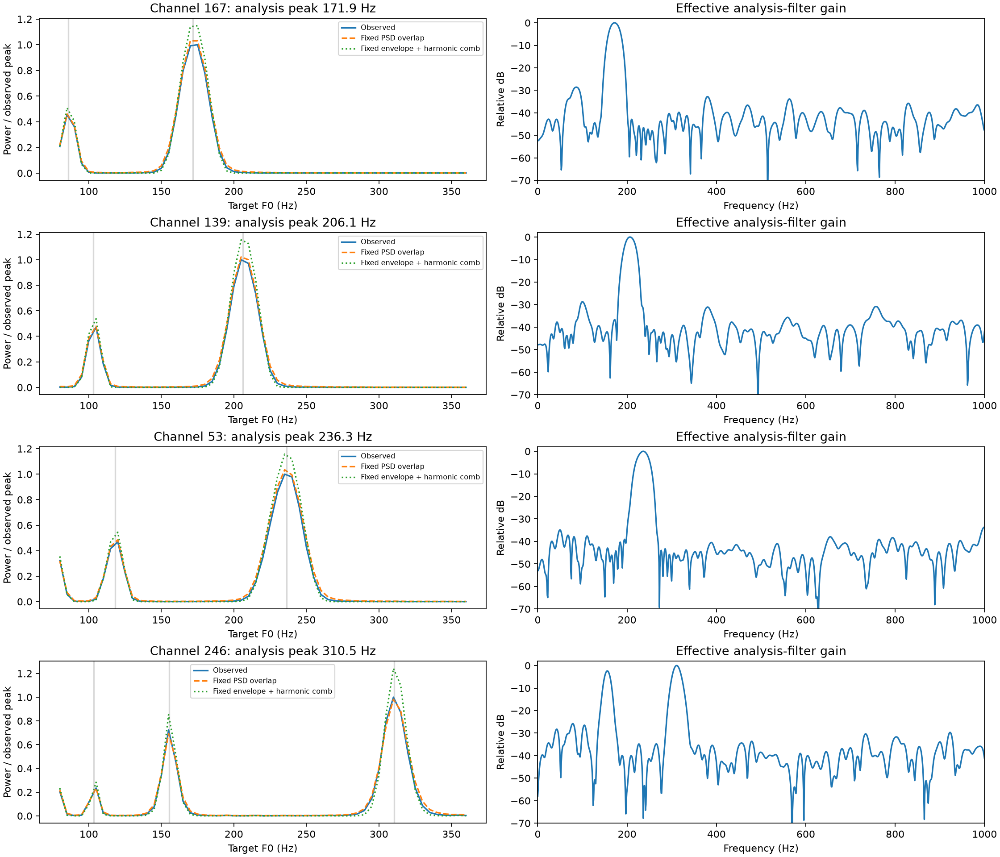
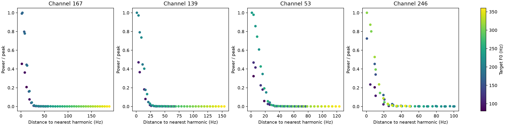
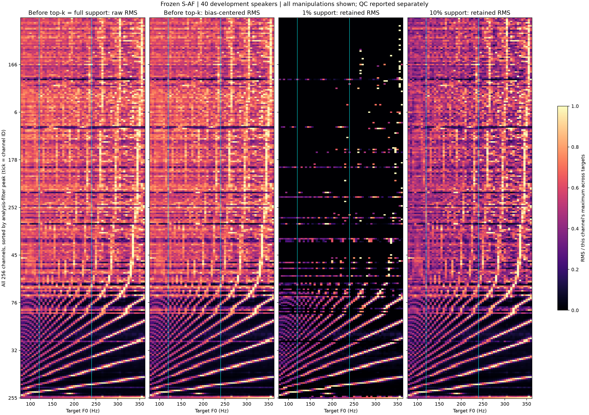
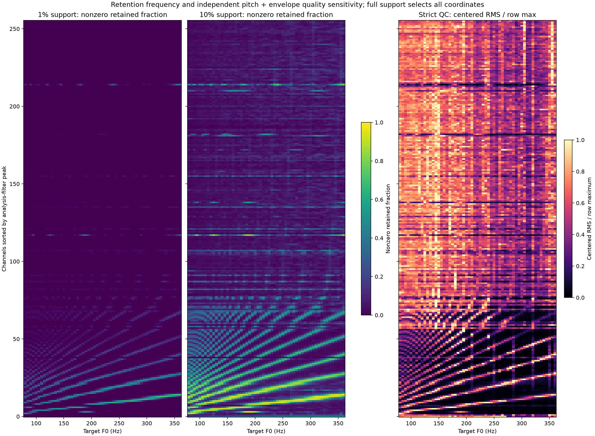
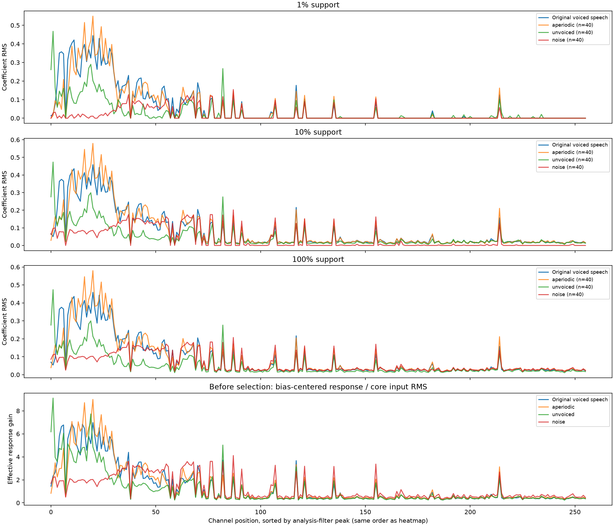

# S-AF controlled pitch intervention

The result supports **learned fixed-frequency analysis and synthesis channels with
nonlinear sparse selection**. In particular, channel 53 responds when a harmonic
passes through its preferred band; it does not remain an active carrier of pitch
information throughout the sweep. This experiment does not establish an
identifiable pitch slot. A distributed population of such filters can still
contain information about pitch.

This is an exploratory development-set result. The independent pitch check works
well, but waveform-envelope preservation is imperfect and limits the strength of
a pitch-only causal interpretation. Both complete and quality-restricted results
are provided below. No weights were trained or changed.

## Data and intervention

The frozen S-AF checkpoint is the same one used in the earlier channel analysis:
SHA-256 `19019fb2f65f7e36947adc7ebd33c266679bee1e013794e4fe7e260625b600cf`.

- **40 dev-clean speakers**, one stable voiced context per speaker. The 200
  recordings used for checkpoint selection were excluded by utterance ID.
  These development speakers were used in checkpoint validation, even though
  the present recordings were not. This is not an untouched evaluation set.
- Each excerpt is **12,288 samples / 0.768 s** at 16 kHz. Its central 4,096
  samples / 256 ms form the source region. The 40 voiced regions represent
  **10.24 seconds of distinct speech**, not thousands of independent sources.
  Sources are selected by voicing, energy and pitch stability, before inspecting
  model responses. Original median pYIN F0 ranges from 60.85 to 291.97 Hz.
- WORLD analysis uses DIO + StoneMask, CheapTrick and D4C: 5-ms frames,
  F0 search 50–600 Hz, spectral FFT 2,048. For each source, **57 constant F0
  targets from 80 to 360 Hz in 5-Hz steps** replace voiced F0 values while its
  estimated spectral envelope and aperiodicity arrays remain exactly fixed.
  This gives **2,280 interventions**. The primary interpretation range is
  **120–240 Hz**: 25 targets × 40 sources = 1,000 interventions.
- References include the original waveform, WORLD resynthesis with the original
  contour (*sham*), and resynthesis flattened to the source's median F0.
  The latter separates contour flattening from shifting to a common target.
- Every input receives the same 10-ms edge fade and whole-excerpt RMS of 0.05.
  Duration is exact. Equal RMS is a level control, not proof of equal perceived
  loudness. Central-region level changes relative to sham have 10th/50th/90th
  percentiles of −0.529/−0.067/+0.362 dB within the primary range.
- Eight deterministic sample-origin shifts `[0,13,29,61,103,157,199,239]`
  reduce phase/stride sensitivity. Only latent positions whose entire
  2,041-sample receptive field remains inside the same source region are scored
  (8 or 9 positions per shift). Shifts and positions are repeated measurements;
  the independent source unit remains the speaker.

**Top-k is applied globally over each entire 0.768-s excerpt**, not per channel
or frame. There are 48 × 256 candidate coordinates: 123 are selected at 1%,
1,229 at 10%, and all 12,288 at full support. These budgets differ in scope from
the earlier whole-utterance study; their channel rankings are not interchangeable.

We measure raw coefficient RMS before selection, bias-centered RMS, retained
coefficient RMS including zeros, and nonzero retention frequency. Powers/rates
are averaged equally across shifts and then speakers. RMS is the square root
of mean power. Rankings use retained RMS at **all three supports**, with average
ranks for ties. Full support selects every coordinate, making selection frequency
uninformative as a ranking criterion. Coefficient magnitude is not reconstruction
importance and depends on the model's channel scaling.

## Manipulation checks and their limitation

Independent pYIN estimates are measured from the resulting waveforms. Pitch QC
requires F0 within 5% of target and at least 80% voiced frames in the source core.
The additional, preset strict check requires coarse log-envelope shape RMSE no
greater than 3 dB relative to sham. This gain-free waveform proxy uses Welch
spectra, cepstral smoothing retaining quefrencies up to 2 ms, and 300–6,000 Hz.
It is an imperfect F0-dependent envelope estimator, not a direct measurement of
the vocal tract or a perceptual timbre test.

| Check | Entire 80–360 Hz sweep | Primary 120–240 Hz range |
|---|---:|---:|
| Pitch QC passes | 2,228 / 2,280 (97.72%) | 976 / 1,000 (97.60%) |
| Pitch + envelope QC passes | 597 / 2,280 (26.18%) | 292 / 1,000 (29.20%) |

Within the primary range, median relative F0 error is **0.188%** and median
coarse-envelope shape drift is **3.63 dB**. Whole-excerpt RMS differs from 0.05
by at most $2.1\times10^{-10}$; every waveform has exactly 12,288 samples.

Fixing WORLD parameters does **not** guarantee an unchanged realized waveform
envelope after harmonic resampling and level normalization. The strict subset
also changes composition with target F0: it contains 26 sources at 120 Hz but
only six at 235 and 240 Hz. Thus its population-average heatmap is a sensitivity
analysis, not a fully matched 40-speaker pitch-only comparison. The within-source
analyses below reduce this composition issue. This experiment should not be
described as a perfect pitch-only manipulation across the complete range.



## Why compare analysis filters, not just decoder peaks?

Both the S-AF encoder and decoder are affine convolutional networks, but their
weights are **untied**. Decoder atom spectra alone do not determine encoder
activation. We extract every effective interior analysis filter by differentiating
an encoder output with respect to its waveform input. For this frozen architecture,

$$
u_c[t]=\beta_c+\sum_{r=-1020}^{1020}h_c[r]x[256t+r].
$$

There is no learned input-conditioned change of $h_c$ before selection. On the
original 40 sources, the direct fixed-filter calculation agrees with actual
encoder coefficients across all 256 channels and scored interior positions
to a maximum absolute error of **$5.85\times10^{-7}$**. This verifies the
architecture's affine mechanism numerically; it is not evidence of semantic
equivalence between channels. Native IEEE FP32 convolutions are used throughout
(cuDNN and CUDA matmul TF32 disabled).

We also test two **unfitted power approximations**, without learning a new gain
or regressor:

$$
P_c^{\rm PSD}\approx\int |H_c(f)|^2S_x(f)\,df,
\qquad
P_c^{\rm harmonic}\approx\sum_m w_m|H_c(mF_0)|^2.
$$

The first uses the observed core waveform's periodogram; the second uses only
the fixed WORLD envelope sampled at harmonic frequencies, normalized to core
input power. Both predict bias-centered coefficient power and discard phase
cross terms/nonstationarity. The second also omits aperiodic energy. They are
approximations to the fixed-filter model, not equivalent to its exact calculation.

Nearest-harmonic diagnostics use

$$
m_c=\max(1,\operatorname{round}(f_c/F_0)),\qquad
d_c=|m_cF_0-f_c|,
$$

where $f_c$ is the **analysis-filter** spectral maximum. A multiband channel
requires the full harmonic sum, not only this nearest-peak distance.

## The four highlighted channels

| Channel | Analysis peak | Median within-source PSD-overlap Spearman, pitch QC [95% CI] | Strict-QC PSD-overlap $R^2$ | Strict-QC harmonic-envelope $R^2$ |
|---|---:|---:|---:|---:|
| 167 | 171.88 Hz | 0.951 [0.935, 0.962] | 0.969 | 0.958 |
| 139 | 206.05 Hz | 0.945 [0.928, 0.965] | 0.983 | 0.964 |
| 53 | 236.33 Hz | 0.951 [0.939, 0.962] | 0.971 | 0.948 |
| 246 | 310.55 Hz, with a second band near 156 Hz | 0.926 [0.895, 0.945] | 0.938 | 0.950 |

Spearman values are medians of within-source correlations over accepted
120–240 Hz targets; 39 speakers have enough accepted targets. The confidence
intervals resample speakers with 2,000 draws, seed 0, and are descriptive,
without multiple-comparison adjustment. $R^2$ uses the unfitted power predictions:
one minus total squared prediction error divided by within-source centered
power variation, pooling sources with at least three accepted targets.
The strict $R^2$ calculations therefore use 23 sources. Separately, strict
within-source correlation summaries require at least eight targets (14 sources).

**Channel 53 gives the clearest answer to the proposed intervention.** Its
mean bias-centered coefficient power is 0.5475 at 120 Hz, falls to 0.00136 at
180 Hz, and rises to 1.1685 at 235 Hz (all 40 sources, descriptive unfiltered
means). At 120 Hz the second harmonic is near its fixed 236-Hz analysis band;
at 235 Hz the fundamental is near that band. It does not follow a continuously
changing F0 as a stable, active pitch coordinate. Its nearest-harmonic proximity
has median within-source Spearman **0.960** with response power in the primary
pitch-QC range.

Channels 167 and 139 similarly favor their fixed bands and subharmonic crossings.
Channel 246 responds around 155 and 310 Hz, consistent with its two fixed analysis
bands. Coordinated changes across these channels are compatible with a filter
bank and do not themselves demonstrate a shared pitch-property slot.



The response curves above show the complete 80–360 Hz sweep, averaged over all
40 sources; the table uses the indicated quality restrictions and primary range.
Grey crossing markers refer only to the strongest analysis peak, so they do not
mark every band of channel 246.



## All 256 channels

The heatmap includes **every channel**, ordered by its analysis-filter peak, with
original channel IDs at the ticks. Each row is normalized by its own maximum
across targets to show response shape; weak channels can therefore appear bright.
Absolute RMS values and rates are in the numeric exports. The full-support
response equals the pre-selection raw response by definition.



Across channels, the median of within-source PSD-overlap Spearman values is
**0.858**; 228 of 256 channels reach at least 0.8. The harmonic-envelope
approximation has a median of **0.816**. Restricting to strict-QC sources with
at least eight accepted primary targets gives channel medians of **0.820** and
**0.794**, respectively.

**These are response-ordering results, not uniformly accurate power predictions.**
For the PSD approximation, median unfitted within-source $R^2$ across all channels
is −0.002 with pitch QC and −2.685 with strict QC; only 127 and 58 channels,
respectively, have positive values. The power approximation is strong for the
four highlighted narrowband channels but inadequate as a universal quantitative
model. Finite contexts, phase terms, nonstationarity, small response variation and
uneven QC coverage can affect these scores; this experiment does not isolate
their separate effects. Approximation errors are not evidence of a hidden pitch
mechanism: the exact affine-filter calculation still matches the coefficients.



This is not yet a synthesis/activation clustering analysis, and the figure does
not establish an independent slot structure or a complete ordered frequency
partition across all channels.

## Original-versus-shifted channel rankings

The following are **median per-source** rank correlations with the original
waveform. Each ranking covers all 256 channels and uses retained RMS, with ties
handled explicitly. Aggregate-population correlations and top-10/top-32 overlap
are also exported; they are higher than many per-source correlations and should
not replace them.

| Version | 1% support | 10% support | Full support |
|---|---:|---:|---:|
| WORLD sham, original contour | 0.923 | 0.857 | 0.902 |
| Flattened to own median F0 | 0.694 | 0.702 | 0.701 |
| F0 = 120 Hz | 0.406 | 0.623 | 0.619 |
| F0 = 180 Hz | 0.387 | 0.468 | 0.454 |
| F0 = 240 Hz | 0.295 | 0.426 | 0.418 |

Rankings change before selection as well as after it; the intervention is not
merely changing top-k membership. The sham and flattening rows also show why
original-versus-shifted differences alone cannot be attributed entirely to pitch.
These ranking summaries include all sources; their exact per-channel ranks at
every target and support are available for inspection.

## Negative controls

Each speaker supplies an audible, signal-labeled unvoiced region selected without
network responses: WORLD at least 98% unvoiced and pYIN at most 10% voiced, within
the 50–600 Hz analysis range. These are **automatic labels, not verified phonetic
annotations**. There are also 40 envelope-matched WORLD aperiodic resyntheses
(zero F0 and unit aperiodicity) and 40 independent seeded Gaussian broadband-noise
excerpts. These controls have no assigned physical F0; no artificial F0 sweep is
claimed for them. The aperiodic resyntheses have median pYIN voiced fraction zero.



The controls activate the channels as well. For example, channel 53's pre-selection,
bias-centered RMS response divided by core input RMS is **5.20** for the
aperiodic control, **4.73** for real signal-labeled unvoiced speech, and **2.10**
for broadband noise. Retention or nonzero response is therefore not a binary
pitch-presence test. The first three panels show actual retained RMS; the last
normalizes pre-selection responses by core input level to reduce energy confounding.

For white noise, fixed filters predict response gain $\|h_c\|_2$. Across all
256 channels, measured noise gains have Spearman **0.9983** with this prediction
and median absolute relative error **1.22%**. This is an additional control for
the fixed-filter measurement, not a semantic specificity test.

## Interpretation and reproducibility

The appropriate name for the first discovered container is a **learned
frequency-selective synthesis channel**, with an associated untied analysis
filter and support competition. The intervention adds evidence that the
highlighted channels respond to harmonic overlap with fixed bands. It does not
demonstrate an input-adaptive transform, an explicit F0 coordinate, independent
constituent properties, or globally optimal sparsity. Pitch information may remain
available in distributed response patterns. A conventional filter-bank baseline
is now necessary before attributing an advantage to a more semantic representation.

The principal limitation is imperfect waveform-envelope control, especially at
large target F0. The numerical mechanism check, negative controls and stricter
subset support the fixed-bank interpretation, while any stronger acoustic-property
claim still requires a fresh evaluation set and better controlled confirmation.
`test-clean` was not used in this experiment. Experiments 2 and 3 remain future work.

Run from the repository root with the existing checkpoint and LibriSpeech cache:

```powershell
python -m pip install -e ".[pitch-analysis]"
$env:OMP_NUM_THREADS='1'
$env:MKL_NUM_THREADS='1'
$env:OPENBLAS_NUM_THREADS='1'
$env:NUMBA_NUM_THREADS='1'
python tools/analyze_pitch.py --workers 8
```

`--stage prepare`, `--stage analyze`, and `--stage report` can be run separately;
preparation and inference reuse completed local files. `--force` recomputes model
responses. `--speakers 2` runs a separate smoke test without overwriting the main
documentation exports. Prepared audio, WORLD parameters, filters and per-source
responses remain under the ignored run directory `analysis/pitch_intervention/`.
The Markdown interpretation is a reviewed record of this frozen experiment;
the script regenerates its numeric exports and figures.

- [Protocol, versions, checkpoint hashes and summary](saf_pitch_analysis.json)
- [Source utterances and crop offsets](saf_pitch_sources.csv)
- [Every manipulation's F0, envelope and level checks](saf_pitch_quality.csv)
- [All-channel RMS and retention, all variants and supports](saf_pitch_activations.csv)
- [Nearest harmonics, response strengths and overlap predictions](saf_pitch_harmonics.csv)
- [All-channel prediction scores and confidence intervals](saf_pitch_channels.csv)
- [Original and shifted channel ranks](saf_pitch_rankings.csv)
- [Rank correlations and overlap summaries](saf_pitch_rank_comparison.csv)
- [Negative-control retained RMS](saf_pitch_controls.csv) and
  [level-normalized gains](saf_pitch_control_gains.csv)

The implementation uses [WORLD — Morise, Yokomori and Ozawa (2016)](https://doi.org/10.1587/transinf.2015EDP7457)
and [CheapTrick — Morise (2015)](https://doi.org/10.1016/j.specom.2014.09.003)
through the [official PyWORLD wrapper](https://github.com/JeremyCCHsu/Python-Wrapper-for-World-Vocoder),
with the earlier pYIN reference checks. Papers examined are recorded as one-line
entries in [bibliography.md](../bibliography.md).
