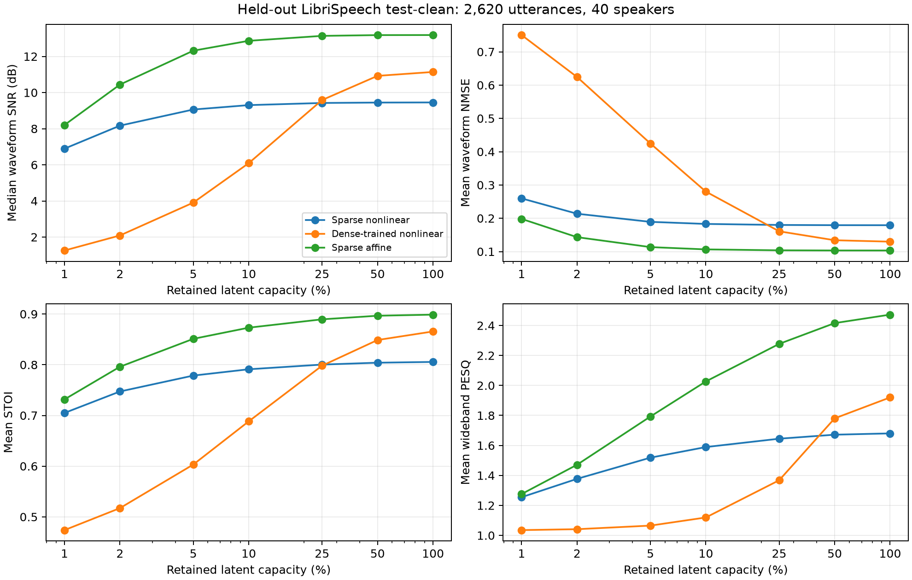

# Held-out sparse autoencoder comparison

Full LibriSpeech test-clean: 2,620 recordings, 40 speakers, approximately 5.40 hours. Frozen best checkpoints from update 20,000; no test-time fitting or test-driven checkpoint selection. All models have 1,002,369 trainable parameters and were trained on the same ten-hour subset.

S-NL = sparse nonlinear; D-NL = dense-trained nonlinear; S-AF = sparse affine. The affine encoder/decoder retain biases, and support selection is nonlinear.

SNR is the utterance median; NMSE, STOI and PESQ are utterance means. Retained fraction refers to valid latent capacity, not a measured bitrate.

| Model | Retained | Values/s | NMSE | SNR dB | STOI | PESQ-WB |
|---|---:|---:|---:|---:|---:|---:|
| S-NL | 1% | 160.3 | 0.2597 | 6.89 | 0.705 | 1.255 |
| D-NL | 1% | 160.3 | 0.7504 | 1.26 | 0.474 | 1.035 |
| S-AF | 1% | 160.3 | 0.1981 | 8.20 | 0.732 | 1.276 |
| S-NL | 2% | 320.6 | 0.2136 | 8.17 | 0.747 | 1.377 |
| D-NL | 2% | 320.6 | 0.6243 | 2.09 | 0.517 | 1.041 |
| S-AF | 2% | 320.6 | 0.1433 | 10.44 | 0.796 | 1.471 |
| S-NL | 5% | 801.3 | 0.1892 | 9.06 | 0.779 | 1.518 |
| D-NL | 5% | 801.3 | 0.4247 | 3.91 | 0.603 | 1.065 |
| S-AF | 5% | 801.3 | 0.1134 | 12.32 | 0.851 | 1.793 |
| S-NL | 10% | 1602.5 | 0.1830 | 9.30 | 0.791 | 1.589 |
| D-NL | 10% | 1602.5 | 0.2801 | 6.09 | 0.688 | 1.119 |
| S-AF | 10% | 1602.5 | 0.1065 | 12.86 | 0.873 | 2.027 |
| S-NL | 25% | 4006.1 | 0.1799 | 9.42 | 0.800 | 1.645 |
| D-NL | 25% | 4006.1 | 0.1608 | 9.59 | 0.798 | 1.368 |
| S-AF | 25% | 4006.1 | 0.1037 | 13.14 | 0.890 | 2.277 |
| S-NL | 50% | 8012.1 | 0.1793 | 9.45 | 0.804 | 1.672 |
| D-NL | 50% | 8012.1 | 0.1340 | 10.92 | 0.849 | 1.780 |
| S-AF | 50% | 8012.1 | 0.1032 | 13.18 | 0.897 | 2.416 |
| S-NL | 100% | 16024.2 | 0.1792 | 9.45 | 0.806 | 1.680 |
| D-NL | 100% | 16024.2 | 0.1298 | 11.14 | 0.866 | 1.920 |
| S-AF | 100% | 16024.2 | 0.1032 | 13.18 | 0.899 | 2.472 |

## Smallest tested support at specified accuracy

Counts mean that at least one of the eight tested codes meets the target. A failure does not prove that no other code or representation could succeed.

| Target NMSE | S-NL successes | D-NL successes | S-AF successes |
|---|---:|---:|---:|
| 0.1 | 1168/2620 | 1511/2620 | 1845/2620 |
| 0.01 | 0/2620 | 1/2620 | 105/2620 |
| 0.001 | 0/2620 | 0/2620 | 0/2620 |

### Matched-recording support comparison

Each row uses only recordings where both models meet the specified tolerance somewhere in the fixed sweep. Ratios compare their smallest tested supports on the same recording; success coverage above must accompany these conditional comparisons. A ratio below one means A retained fewer values. The paired JSON also records one-sided successes and failures.

| A / B | NMSE target | Both succeed | Median support ratio A/B | A uses fewer values |
|---|---:|---:|---:|---:|
| S-NL / D-NL | 0.1 | 1168 | 0.080 | 1134 |
| S-AF / S-NL | 0.1 | 1168 | 0.500 | 804 |
| S-AF / D-NL | 0.1 | 1510 | 0.080 | 1510 |
| S-AF / D-NL | 0.01 | 1 | 0.100 | 1 |

## Findings

At 1% support, sparse nonlinear training gives 6.89 dB median SNR, versus 1.26 dB for dense training followed by pruning. This directly tests the value of training the representation to survive sparsification.

At 10% support the affine control reaches 12.86 dB, versus 9.30 dB for sparse nonlinear and 6.09 dB for dense-trained nonlinear. This is a comparison of these trained models, not a proof that affine representations are universally best.

At full support, median SNR is 9.45 dB (S-NL), 11.14 dB (D-NL), 13.18 dB (S-AF). Any full-support reconstruction error exists before discarding latent values; it cannot be attributed solely to an insufficient sparse budget.

**Architecture limitation:** for a two-second, 32,000-sample input, encoder stage E4 has 128 channels x 125 time steps = 16,000 values. A final 1x1 projection expands them to 32,000 latent slots; the decoder starts by projecting 256 channels back to 128. Thus all three baselines compress information before top-k. The affine analysis and synthesis operators have rank at most 16,000 at this input length. This rules out a general lossless dense reference, although it does not prove a particular speech-error floor. The earlier interpretation that only sparsification creates a bottleneck was incomplete.

The fewest successful scalar values among a finite sweep are achieved supports. No minimum-support certificate, optimized sparse bitstream, or guarantee over all representations is provided. The three runs use one training seed and one clean English speech corpus. Tests involve unseen speakers but do not establish transfer to all audio or signals.

## Uncertainty and interpretation

Paired differences and 95% percentile bootstrap intervals are in [sparse_autoencoder_test_paired.json](sparse_autoencoder_test_paired.json). They resample 40 speakers with 2,000 draws under seed 0, after averaging matched utterance differences within each speaker. These are intervals for a mean difference, not for the median SNR or variability across training seeds.

PESQ/STOI validity counts, checkpoint hashes, original training source fingerprints, and the frozen test protocol are in [the provenance record](sparse_autoencoder_test_runs.json). ViSQOL was not integrated. Inference times are contended and are not used for model-speed claims.

Reproduce with `python tools/compare_models.py`. This also regenerates the numeric export and LaTeX table from the completed local runs; datasets and checkpoints stay local.
